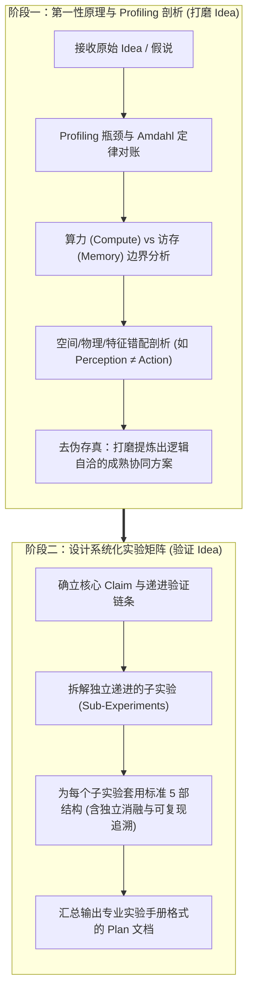

# 科学实验计划制定规范 (Experiment Plan Designer)

本技能定义了从 **“第一性原理与 Profiling 剖析打磨 Idea”** 到 **“确立成熟 Idea 并设计递进式子实验计划”** 的标准制定流程与文档组织规范。所有实验计划必须按照专业实验手册风格撰写，使用结构化表格与规范条目呈现，确保逻辑严密、自变量解耦清晰、便于快速阅读与审核。

---

## 一、实验计划制定的两大前置阶段

### 阶段 1：根据第一性原理与 Profiling 瓶颈剖析 Idea，辅助打磨

在下笔设计具体测试之前，必须先进行理论与实测对账，回答 **“这个 Idea 在物理上到底能不能成立？收益天花板在哪里？”**：
1. **Amdahl 定律与全链路瓶颈对账**：
   - 检查优化目标在整个推理/计算耗时中的绝对占比。如果优化对象仅占 10% 耗时，无论怎样加速都无法带来显著端到端提升；
   - 识别瓶颈物理属性：区分 **Compute-Bound（算力受限，看 FLOPs/GEMM）** 与 **Memory-Bound（访存受限，看 DRAM 带宽、SRAM 驻留量、GEMV 访存比）**；
2. **第一性原理与物理机制审视**：
   - 剖析既有方案的核心缺陷（例如：感知模型更关注全图大物体语义，而底层控制高度聚焦机械臂夹爪与接触点物理热点，存在内在错位）；
   - 评估改动对因果时序、坐标连续性与数值稳定性的影响（如 RoPE 绝对位置编码不可直接打乱重排）；
3. **方案打磨与升级**：
   - 剔除收益微弱或已被前人穷尽的无意义点（如单纯跳步、单点小微剪枝）；
   - 将孤立的 Trick 升级为 **“计算瓶颈削减 + 访存瓶颈消除”** 的软硬件协同闭环方案。

---

### 阶段 2：确立成熟 Idea，设计结构化递进实验计划

将打磨后的核心方案拆解为**逻辑闭环、层层递进**的子实验链条。一般的递进逻辑应遵循：
$$\text{机理必要性证明 (Why?)} \to \text{物理特征真实性 (Is it valid?)} \to \text{算法连接可行性 (Can it bridge?)} \to \text{真实任务效果 (Efficacy)} \to \text{系统端到端收益 (Speedup)}$$

---

## 二、子实验规范组织结构（标准 5 部法）

实验计划中的每一个子实验，**必须严格按照以下 5 个结构块顺序撰写**，不得随意合并或遗漏：

### 1. 实验名称 (Experiment Name)
- 格式：`实验 X：[清晰明了的模块全称] ([英文简称/代号])`
- 要求：简明指出本实验所测的核心机制（如：`实验一：感知显著性 vs 控制显著性空间错位分析 (Perception-Action Mismatch)`）。

### 2. 实验目的 (Experiment Objective)
- 格式：采用精炼的论述，明确回答：
  - **核心科学/工程问题**：本实验要验证什么猜想、击破什么质疑？
  - **在整体验证链中的定位**：为什么该实验是后续实验的前提？

### 3. 实验矩阵 (Experiment Matrix)
必须按照 **“指标定义表 $\to$ 独立消融矩阵 $\to$ 完整实验配置表”** 的逻辑逐层推进：

#### (1) 主要指标定义与计算方式表 (Metrics Table)
在进入实验配置前，**先用表格清晰介绍主要指标的物理含义与数学公式**，让用户先建立统一认知：

| 评估指标 (Metric) | 符号表示 | 物理/统计含义 | 数学计算公式 / 定义 | 期望目标 |
| :--- | :--- | :--- | :--- | :--- |
| **空间交并比** | $\text{IoU}$ | 衡量感知与控制关注 Token 集合的空间重叠度 | $\frac{|\mathcal{S}_{\text{VLM}} \cap \mathcal{S}_{\text{Action}}|}{|\mathcal{S}_{\text{VLM}} \cup \mathcal{S}_{\text{Action}}|}$ | $< 0.35$ (证明错位) |
| **控制能量召回率** | $\text{Recall}$ | 被选中集合覆盖真实动作注意力的总能量比例 | $\frac{\sum_{i \in \mathcal{S}} A_{\text{Action}}[i]}{\sum_{j} A_{\text{Action}}[j]}$ | $\ge 80\%$ (高召回) |
| **任务成功率** | $\text{SR}$ | 闭环物理仿真中达到成功判定状态的试验比例 | $\frac{N_{\text{success}}}{N_{\text{total}}} \times 100\%$ | $\uparrow$ 逼近 Full Dense |

#### (2) 独立消融维度矩阵 (Dedicated Ablation Matrix)
若涉及多维正交变量（如特征来源 $\times$ 时域滤波方式），**必须独立建表解耦消融维度**，避免淹没在冗长参数中：

| 维度一：特征制导来源 (Source) \ 维度二：时域处理 (Temporal) | Single (当帧单步) | EMA (滑动时域均值) | EMA + Dilation (时域均值 + 空间膨胀) |
| :--- | :--- | :--- | :--- |
| **VLM-Guided (纯感知语义)** | `vlm_single` | `vlm_ema` | `vlm_ema_dilation` |
| **Action-Guided (纯控制注意力)** | `action_single` | `action_ema` | `action_ema_dilation` |
| **Hybrid (感知与控制协同并集)** | `hybrid_single` | `hybrid_ema` | `hybrid_ema_dilation` |

#### (3) 完整实验执行配置表 (Execution Matrix Table)
明确每组实验的具体超参数、评测任务、轮次与成对随机种子：

| 实验组别 / 变体方法 | 自变量关键配置 (Key Config) | 评测任务与环境 | 测试轮次 (Trials/Rounds) | 随机种子范围 (Random Seeds) | 依赖指标与输出列 (Dependent Metrics) |
| :--- | :--- | :--- | :--- | :--- | :--- |
| **Baseline A** | $r = 1.0$ (Full Dense) | Task 0 ~ 4 | 10 trials / task (共 50 场) | seeds: 1000 ~ 1009 | SR %, Replan Steps, Latency (ms) |
| **Baseline B** | $r = 0.25$ (Random) | Task 0 ~ 4 | 10 trials / task (共 50 场) | seeds: 1000 ~ 1009 | 同上 |
| **Ours (Champion)**| $r = 0.25$, $W=3$, Dil=3x3 | Task 0 ~ 4 | 10 trials / task (共 50 场) | seeds: 1000 ~ 1009 | 同上 |

### 4. 实验方案 (Implementation Protocol)
包含实施所需的具体工程要素：
1. **实验环境与硬件**：使用的 GPU 型号、显存、CUDA/PyTorch 版本、仿真平台（如 LIBERO/MuJoCo）及预训练模型权重版本；
2. **输入数据基底**：注明使用的数据源（必须使用真实策略连续 Rollout 轨迹，杜绝静止 Dummy 动作帧误导）；
3. **模型挂载与实施路径**：说明 Hook 注册位置、前向计算流拦截点、断点存储机制；
4. **脚本执行命令示例**：提供单行可复现的 Bash 运行命令。

### 5. 实验结果与交付物 (Expected Deliverables & Criteria)
严格包含以下 5 项完整交付内容：
1. **定量数据产出**：输出 CSV/JSON 文件路径与核心字段清单（严格 Schema）；
2. **可视化绘图规划**：图表文件路径、Panel 布局架构（如 2x2 或 3x2 Composite Figure）、子图横纵坐标含义、误差棒（如 Wilson 95% CI）标准；
3. **实验报告沉淀 (Experiment Report Integration)**：明确说明本实验产出是形成独立 Markdown 报告（如 `outputs/expX_report.md`）还是即时汇入全局总实验报告（如 `EXPERIMENT_REPORT.md` 中的对应章节），包含实测数据、现象归因与结论；
4. **实验可复现记录 (Reproducibility & Traceability Ledger)**：
   - 记录确切代码 Git Commit 哈希、Conda 环境依赖；
   - 固化成对随机种子清单与输入数据校验签名（SHA256 Manifest）；
   - 提供独立无污染的单行重现命令；
5. **量化判据 (Go / No-Go Criteria)**：
   - **通过判据 (Go)**：指标达到何种定量阈值（例如：$r=25\%$ 时 $\text{IoU} < 0.35$ 且 $\text{Recall} \ge 80\%$），则证明假设成立，准予进入下一阶段；
   - **失败判据 (No-Go)**：若指标未达标，对应的归因分析与备选调整路径。

---

## 三、执行落地追踪：按实验矩阵建立独立 Task 清单与判据动态标注

实验计划（`plan_<idea>.md`）作为方案设计基准，应保持相对静态；而在实验执行与调度落地期间，**必须独立建立专用的执行跟踪看板文件（如 `docs/TASK_LIST.md`）**。该文件根据实验计划中的实验矩阵生成，负责高频记录执行状态、进程会话与判据对账结果，实现“方案设计”与“动态追踪”彻底解耦：

### 1. Task 清单组织原则
- **独立文件存储**：脱离 Plan 文档独立建档（如 `docs/TASK_LIST.md`，配套模板见 [experiment_task_list_template.md](./references/experiment_task_list_template.md)），避免频繁更新执行状态污染设计方案的 Git 版本历史；
- **粒度严格对齐**：每个 Task 项严格对应实验矩阵中的一个子实验（或核心消融批次/阶段）；
- **前置依赖明确**：清晰标注任务间的因果依赖（例如“Stage 2 Pareto 扫描严格依赖 Stage 1 决出的 Champion 策略”）；
- **判据前置绑定**：每个 Task 项直接链接该实验对应的量化 Go/No-Go 判据，而不是笼统的“运行脚本”。

### 2. 状态标注规范 (Status Legend)
在实验执行与巡检过程中，动态更新 Task 清单状态：
- `[ ]` **未开始 (Pending)**：等待前置任务完成或尚未启动；
- `[-]` **运行中 (In Progress)**：后台已启动（如已提交 tmux 或正在执行），记录进程 PID 或 tmux session；
- `[x]` **已完成并通过 (Passed / Go)**：实测指标达到设定的通过判据（Go），交付物与测试门禁全部就绪；
- `[!]` **受阻或未达标 (Failed / No-Go)**：实测指标未达到判据或发生执行异常，触发归因分析或方案调整。

### 3. Task 清单标准排版示例

| 任务 ID | 子实验模块 | 核心矩阵配置 / 轮次 | 负责脚本 / 命令 | 对应 Go 判据 | 当前状态 | 备注 / 关键指标结果 |
| :--- | :--- | :--- | :--- | :--- | :---: | :--- |
| **TASK-1** | 实验一：错位分析 | 7 档保留率, 38 步 (266 组合) | `run_exp1_mismatch.py` | $r=20\%$ 时 $\text{IoU}<0.35$ 且 $\text{Recall}>75\%$ | `[x] PASS` | 实测 IoU=0.28, Recall=79.2% (Go) |
| **TASK-2** | 实验二：物理稀疏 | 10 步 $\times$ 18 层 (6,840 组合) | `run_exp2_sparsity.py` | 深层 $R_{90\%} \le 0.08$ 且物理热点非 Sink | `[x] PASS` | Layer 13-17 能量集中度 0.04 (Go) |
| **TASK-3** | 实验三：跨帧平滑 | 6 档保留率, 36 步 (648 组合) | `run_exp3_temporal_guidance.py` | EMA+Dil 跨帧召回率 $\ge 80\%$ | `[x] PASS` | 实测召回率 83.5% (Go) |
| **TASK-4a-1**| 实验 4a: Stage 1 | 13 方法 $\times$ 5 任务 $\times$ 10 种子 | `eval_closed_loop_pruning.py` | Hybrid 成功率不低于 Dense | `[-] RUN` | seeds 1000~1004 已完成，1005~1009 运行中 |
| **TASK-4a-2**| 实验 4a: Stage 2 | Champion + 4 基线 $\times$ 4 档 $r$ | `run_stage2_pareto.py` | 绘制 Pareto 前沿且步数稳定 | `[ ] PEND` | 依赖 TASK-4a-1 选出 Champion |

---

## 四、实验计划文档的专业手册排版风格规范

撰写整篇 Plan 时，必须遵照专业实验手册标准排版，提高阅读与审核效率：
1. **多用表格，拒绝散文堆砌**：指标定义、消融矩阵、执行配置、输出清单一律使用 Markdown 表格整理；
2. **图示与公式精准**：使用 Mermaid 图绘制数据流与网络前向 Hook 拦截点；使用 KaTeX 规范渲染公式；
3. **断点续跑与幂等性保障**：在方案中显式注明日志与 CSV 的断点去重 Key `(method, retention_ratio, task_id, episode_idx)`，支持长任务中断后无冲突恢复。
